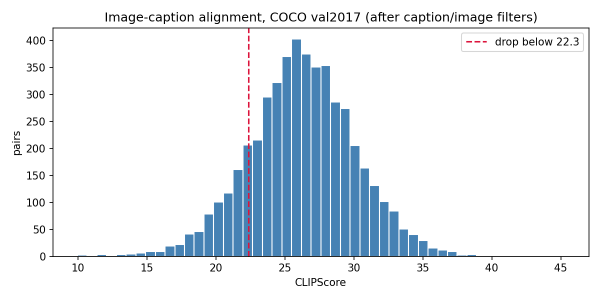
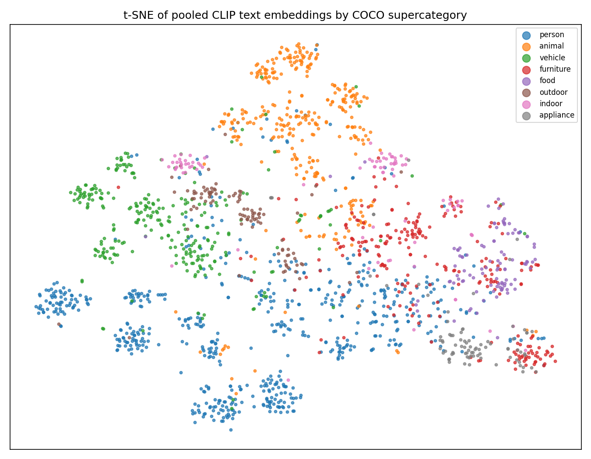
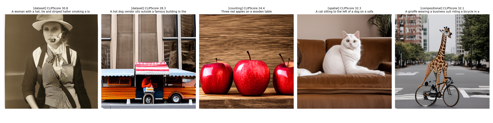
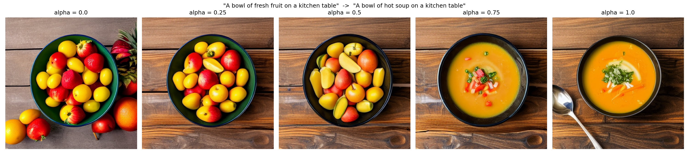

# Text-to-Image Generation with Stable Diffusion on COCO

Text-to-image generation using Stable Diffusion 1.5 and its CLIP ViT-L/14 text encoder, built on a cleaned 4,189-pair subset of COCO val2017.

## Milestone 1: Data, Environment, and Text-to-Embedding Baseline

### Dataset

COCO 2017 val split: 5,000 images with 25,014 human-written captions.

| Stage | Pairs |
|---|---|
| Raw COCO val2017 | 5,000 images, 25,014 captions |
| Caption cleaning (normalize, dedupe, 5-40 words, 77 CLIP tokens or fewer, keep longest valid caption) | 5,000 |
| Image filter (short side 256 px or larger, aspect ratio 2:1 or less) | 4,926 |
| CLIPScore filter (drop bottom 15%, threshold 22.34) | **4,189** |

Images are center-cropped to 512x512 and stored in Hugging Face ImageFolder format (`metadata.jsonl` with `file_name`, `text`, `category`, `clip_score`).



### Text-to-Embedding Pipeline

Captions are tokenized with the SD 1.5 CLIP tokenizer (padded to 77 tokens) and encoded with the SD 1.5 CLIP text encoder:

- `last_hidden_state`: [77, 768], the per-token conditioning the UNet cross-attends to
- `pooler_output`: [768], a sentence-level vector used for analysis

Sanity checks on 2,000 captions:

| Metric | Value |
|---|---|
| Mean cosine similarity, same COCO supercategory | 0.295 |
| Mean cosine similarity, different supercategory | 0.216 |
| Gap | 0.079 |

Generating from precomputed embeddings (`prompt_embeds`) reproduces the text-prompt output exactly (mean absolute pixel difference 0.00), confirming the encoded embeddings are the conditioning signal.



### Baseline Generations

Stable Diffusion 1.5, fp16, DPM-Solver++ scheduler, 25 steps, guidance 7.5, seed 42, on a Colab T4 (about 5 s per image).

| Type | Prompt | CLIPScore (generated) | CLIPScore (real image) | Observed |
|---|---|---|---|---|
| Dataset | A woman with a hat, tie and striped halter smoking... | 30.77 | 26.39 | Attributes correct, artifact around mouth |
| Dataset | A hot dog vendor sits outside a famous building... | 28.34 | 30.73 | Vendor correct, building generic |
| Counting | Three red apples on a wooden table | 24.38 | - | Count correct, one apple cropped |
| Spatial | A cat sitting to the left of a dog on a sofa | 32.31 | - | Dog missing |
| Compositional | A giraffe wearing a business suit riding a bicycle in a city street | 32.12 | - | Suit missing |



**Key finding:** CLIPScore does not track prompt correctness. The spatial sample omits the dog entirely and still scores highest, while the correct counting sample scores lowest. Later milestones will add object, count, and attribute checks rather than relying on CLIPScore alone.



## Repository Structure

```
notebooks/
  01_data_prep.ipynb                 download, clean, CLIP-filter, export dataset
  02_text_embedding_baseline.ipynb   tokenization, embeddings, sample generations
outputs/
  figures/                           plots and sample grids
  samples/                           generated images and results.csv
requirements.txt
```

## Running

Both notebooks run on free Google Colab with a T4 GPU.

1. Run `01_data_prep.ipynb`. It downloads COCO val2017 and writes the cleaned dataset to `MyDrive/t2i_project/data/coco_clean.zip`.
2. Run `02_text_embedding_baseline.ipynb`. It restores the dataset from Drive and runs the embedding analysis and generations.

The dataset itself is not committed. Model weights are cached on local Colab disk.

## Team

| Member | Role |
|---|---|
| TBD | Data pipeline and cleaning |
| TBD | Text embedding analysis |
| TBD | Generation and evaluation |
